

  

  
  
  
  

## About

AI & Data Science undergraduate at **KPR Institute of Engineering and Technology**, curious about how intelligent systems work and how technology solves real-world problems. I turn ideas into practical projects, from AI-powered apps and LLM-based systems to full-stack platforms, always focused on understanding the engineering behind what I build.

- **Building:** AI-powered applications, full-stack products, and intelligent systems
- **Exploring:** LLMs, RAG, AI agents, and scalable software architecture
- **Focused on:** Strengthening problem-solving, software engineering, and practical AI skills
- **Open to:** Internships, collaborative projects, and hackathons

## Featured work

  
  <a href="https://github.com/its-sudharshan-45/YOUR-SEMESTERSWAP-REPO" target="_blank" rel="noopener noreferrer"></a>

  

## Professional Experience

**Full Stack Developer Intern (MERN)** · Codec Technologies 
Nov 2025 – Dec 2025

Built responsive React.js and Bootstrap interfaces backed by Node.js and Express.js REST APIs with MongoDB, connected through asynchronous communication. Secured the applications with JWT/OAuth authentication and Git-based version control, shipping them end to end through full-stack deployment workflows.

**Full Stack Developer Intern** · OneDot Communications 
Dec 2025 – Jan 2026

Implemented secure JWT/OAuth 2.0 authentication with role-based access control and built Node.js and Express.js REST APIs integrated with React frontends. Deployed on Vercel and Render with CI/CD workflows, optimizing frontend performance and backend queries for reliable, production-ready delivery.

### 💻 I code in

  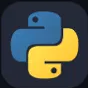
  
  
  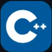
  
  
  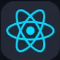
  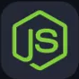
  
  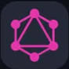
  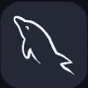
  
  
  
  
  
  
  
  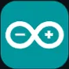

### 🛠️ Tools I use

  
  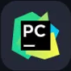
  
  
  
  
  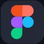
  
  

## GitHub contribution graph

  

